<picture>
  <source media="(prefers-color-scheme: dark)" srcset="assets/engrix-banner-dark.svg">
  
</picture>

# Engrix

Engrix is an independent software brand — one developer, no committee — building
automation systems, backend APIs, and developer tooling: the kind of software
that quietly handles the boring parts so people don't have to.

What Engrix builds, in short:

- ⚙️ **Automation** — scripts, workflows, and pipelines that turn repeated work into a single command
- 🔌 **Backend APIs** — clean, well-typed services that hold products together
- 🛠️ **Developer tooling** — gateways, adapters, and the glue between systems

  
  &nbsp;&nbsp;
  

Every product here started as a tool that was actually needed, got battle-tested
in daily use, then shipped.

## Projects

- **[engrix-router](https://github.com/engrix/engrix-router)** — an API gateway that routes requests across multiple providers. Typed, tested, CI'd.
- **[engrix-router-providers](https://github.com/engrix/engrix-router-providers)** — provider adapters that plug into the router.
- **engrix-agent** — a personal automation platform with its own toolbox and skills — mostly private, for now.

## Toolbox

  

  

## Contact

- ✉️ **engrixdev@outlook.com**
- 💬 Telegram: [@engrix](https://t.me/engrix)
